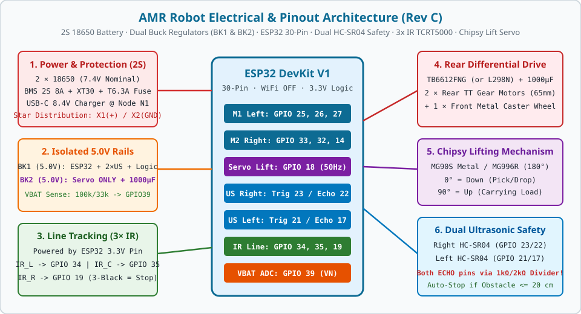
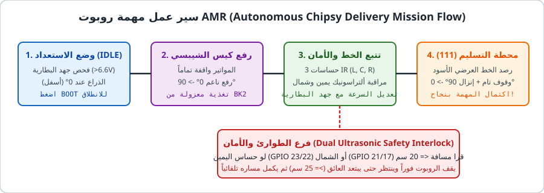

# 🤖 مشروع التخرج: روبوت AMR ذكي لتتبع الخط، تفادي العوائق، ورفع الحمولة (Chipsy Carrier AMR)



مستودع الكود والمخططات الكهربية والمحاكاة التفاعلية لمشروع تخرج **روبوت ذاتي الحركة (Autonomous Mobile Robot - AMR)** يعمل بنظام الدفع التفاضلي الخلفي (**2 عجلة خلفية بجيربوكس + عجلة حرة أمامية Caster Wheel**)، مزود بنظام تتبع المسار (**3 حساسات IR TCRT5000**)، ونظام أمان مزدوج لتفادي العوائق من الجانبين والأمام (**2 حساس ألتراسونيك HC-SR04 يمين وشمال**)، وذراع سيرفو لرفع وإنزال الحمولة (**كيس شيبسي**) في محطات التحميل والتسليم.

---

## ✨ مميزات النظام والمراجعة الهندسية (Rev C)



1. **عزل كامل لدائرة الباور (Dual Buck Architecture):**
   - المنظم الأول **`BK1 (5.0V)`** مخصص لتغذية الـ **ESP32** وحساسين الألتراسونيك ومنطق الدرايفر.
   - المنظم الثاني **`BK2 (5.0V)`** مع مكثف **`1000µF`** مخصص لتغذية **موتور السيرفو فقط** لمنع حدوث هبوط في الجهد (**Brownout Reset**) لحظة رفع كيس الشيبسي.
2. **أمان مزدوج يمين وشمال (Dual Ultrasonic Safety):**
   - حساس ألتراسونيك أيمن (`GPIO 23 / 22`) وحساس ألتراسونيك أيسر (`GPIO 21 / 17`) مع مقسمات جهد (`1kΩ / 2kΩ`) لحماية مداخل الـ ESP32 من الـ `5V`.
   - يقف الروبوت تلقائياً فور اقتراب أي عائق لمسافة `≤ 20 سم` على اليمين أو الشمال، ويستأنف حركته تلقائياً عند ابتعاد العائق (`≥ 25 سم`).
3. **تعويض هبوط جهد البطارية أوتوماتيكياً (Active Battery Compensation):**
   - يقرأ الـ ESP32 جهد بطارية الـ `2S (7.4V)` لحظياً عبر طرف `GPIO 39 (VN)` ومقسم `100kΩ / 33kΩ`، ويعوّض الـ PWM أوتوماتيكياً لتظل سرعة الروبوت ثابتة سواء البطارية مشحونة (`8.4V`) أو في منتصف التفريغ (`7.0V`)، مع فصل آمن للمواتير تحت `6.6V`.
4. **دعم البدائل الاقتصادية في السوق المصري:**
   - الكود والمخطط متوافقان 100% مع كل من درايفر **`TB6612FNG`** (الأوفر والأعلى كفاءة) ودرايفر **`L298N`** التقليدي، ومع سيرفو **`MG90S Metal`** أو **`MG996R`**.

---

## 📂 محتويات المستودع (Repository Structure)

| الملف / المجلد | الوصف |
|---|---|
| [`AMR_Graduation_Full/AMR_Graduation_Full.ino`](AMR_Graduation_Full/AMR_Graduation_Full.ino) | **الكود الرئيسي الكامل للروبوت** (تتبع الخط + ألتراسونيك يمين وشمال + رفع وإنزال الشيبسي + أوامر اختبار البنش) |
| [`E04_3D_Wiring.html`](E04_3D_Wiring.html) | **محاكي البنوز والتوصيلات التفصيلي 3D + مُكبّر البوردات** (يعرض الـ 30 بن الفعلية للـ ESP32 وبنوز كل المكونات سلكاً بسلك) |
| [`مخطط التوصيل والمحاكاة الشاملة — روبوت AMR (E‑01 Rev C).html`](مخطط%20التوصيل%20والمحاكاة%20الشاملة%20—%20روبوت%20AMR%20(E‑01%20Rev%20C).html) | **محاكي الدائرة الكهربية التفاعلي الشامل** لاختبار التوصيلات والجهود والأخطاء قبل التوصيل العملي |
| [`دائرة الباور — روبوت AMR (E‑02).html`](دائرة%20الباور%20—%20روبوت%20AMR%20(E‑02).html) | **مخطط ومحاكاة دائرة الباور وتوزيع الأسلاك (`W01–W53`)** ومنظر الـ 3D لصندوق الباور |
| [`اختبار البنش — روبوت AMR (E‑03).html`](اختبار%20البنش%20—%20روبوت%20AMR%20(E‑03).html) | **دليل ومحاكاة اختبارات البنش الخمسة** وحاسبة معاملات المعايرة (`TRIM_L`, `TRIM_R`, `SERVO_US`, `VBAT_CAL`) |
| [`تقرير_المراجعة_الهندسية_والبدائل_AMR_RevC.md`](تقرير_المراجعة_الهندسية_والبدائل_AMR_RevC.md) | **تقرير المراجعة الهندسية، تحسين التكلفة (توفير +800 جنيه)، وأفضل أماكن الشراء من القاهرة والعاشر** |

---

## 🔌 جدول توصيل الأطراف المعتمد (ESP32 30-Pin Pinout)

| المكون | طرف المكون | طرف الـ ESP32 | مصدر التغذية | ملاحظات الحماية (إجبارية) |
|---|---|---|---|---|
| **موتور شمال (M1)** | `ENA` / `IN1` / `IN2` | `GPIO 25` / `26` / `27` | `VBAT (7.4V)` | مقاومة `10kΩ` بين `GPIO 25` والأرضي |
| **موتور يمين (M2)** | `ENB` / `IN3` / `IN4` | `GPIO 33` / `32` / `14` | `VBAT (7.4V)` | مقاومة `10kΩ` بين `GPIO 33` والأرضي لمنع نبضة الإقلاع على `14` |
| **سيرفو رفع الشيبسي** | `Signal (PWM)` | `GPIO 18` | **`5.0V (BK2)` منفصل** | مقاومة `1kΩ` توالي على الإشارة + مكثف `1000µF` على فيشة الباور |
| **ألتراسونيك يمين (`US_R`)** | `TRIG` / `ECHO` | `GPIO 23` / `GPIO 22` | `5.0V (BK1)` | **`ECHO` يمر عبر مقسم جهد `1kΩ (فوق) / 2kΩ (أرضي)`** |
| **ألتراسونيك شمال (`US_L`)** | `TRIG` / `ECHO` | `GPIO 21` / `GPIO 17` | `5.0V (BK1)` | **`ECHO` يمر عبر مقسم جهد `1kΩ (فوق) / 2kΩ (أرضي)`** |
| **حساس خط شمال (`IR_L`)** | `DO` | `GPIO 34` | `3.3V (من ESP32)` | تغذية `3.3V` تجعل الخرج آمن بدون مقسم |
| **حساس خط وسط (`IR_C`)** | `DO` | `GPIO 35` | `3.3V (من ESP32)` | تغذية `3.3V` من الـ ESP32 |
| **حساس خط يمين (`IR_R`)** | `DO` | `GPIO 19` | `3.3V (من ESP32)` | تغذية `3.3V` من الـ ESP32 |
| **قراءة جهد البطارية** | مقسم `100kΩ / 33kΩ` | `GPIO 39 (VN)` | `X1 (VBAT)` | `100kΩ` من الموجب و `33kΩ` للأرضي + مكثف `100nF` |
| **زرار التشغيل / لمبة الحالة** | `BOOT` / `LED` | `GPIO 0` / `GPIO 2` | مدمج بالبوردة | لا توصل أي أسلاك خارجية على `0` أو `2` |

---

## 💻 دليل التسطيب خطوة بخطوة على أي جهاز كمبيوتر (Setup Guide)

يمكن لأي فرد في فريق المشروع تشغيل وتعديل الكود على جهازه باتباع هذه الخطوات الـ 5 البسيطة:

### الخطوة 1: تحميل برنامج Arduino IDE 2.x
1. حمّل وثبّت آخر إصدار من **[Arduino IDE 2.x](https://www.arduino.cc/en/software)** (مجاني، يعمل على Windows / macOS / Linux).

### الخطوة 2: تعريف كابل الـ USB لبوردة الـ ESP32 (CP2102 أو CH340)
- أغلب بوردات `ESP32 DevKit V1 (30-Pin)` في السوق المصري تستخدم شريحة **CP2102** (مربعة صغيرة جنب الـ USB) أو **CH340** (مستطيلة):
  - لو الشريحة **CP2102**: حمّل تعريف [Silicon Labs CP210x Windows Driver](https://www.silabs.com/developers/usb-to-uart-bridge-vcp-drivers).
  - لو الشريحة **CH340**: حمّل تعريف `CH341SER.EXE`.
- وصّل الـ ESP32 باللابتوب بكابل **USB ينقل داتا** (وليس كابل شحن فقط)، وتأكد من ظهور رقم `COM Port` في `Device Manager -> Ports (COM & LPT)`.

### الخطوة 3: إضافة حزمة بوردات ESP32 الرسمية (إصدار 3.x)
1. افتح برنامج **Arduino IDE**، واضغط من القائمة العلوية على **`File -> Preferences`**.
2. في خانة **`Additional boards manager URLs`**، الصق الرابط الرسمي التالي واضغط **OK**:
   ```text
   https://espressif.github.io/arduino-esp32/package_esp32_index.json
   ```
3. افتح **`Tools -> Board -> Boards Manager`** (أو أيقونة البوردات على اليسار)، وابحث عن **`esp32`**.
4. اختر **`esp32 by Espressif Systems`** (تأكد أن الإصدار **`3.0.x` أو أحدث** لأن الكود يستخدم دوال `ledcAttach` الحديثة الخاصة بـ Core 3.x) واضغط **Install**.

### الخطوة 4: فتح الكود ورفعه على الـ ESP32
1. افتح الملف [`AMR_Graduation_Full/AMR_Graduation_Full.ino`](AMR_Graduation_Full/AMR_Graduation_Full.ino) في Arduino IDE.
2. من قائمة **`Tools -> Board -> esp32`** اختر **`ESP32 Dev Module`**.
3. من قائمة **`Tools -> Port`** اختر منفذ الـ `COM` الخاص بالـ ESP32.
4. **قاعدة أمان هامة جداً:** تأكد أن **سويتش بطارية الروبوت مقفول (`OFF`)** قبل توصيل كابل الـ USB.
5. اضغط زر **`Upload` (السهم `→`)**:
   - *ملاحظة:* إذا ظهرت كلمة `Connecting.....` في الشاشة السوداء بالأسفل لأكثر من ثانيتين، اضغط بإصبعك على زرار **`BOOT`** الموجود على بوردة الـ ESP32 لمدة ثانية واحدة حتى يبدأ الرفع (`Writing at 0x00010000...`).

### الخطوة 5: الاختبار والمعايرة والتشغيل (How to Use)
1. **اختبار الحساسات على اللابتوب (`Serial Monitor`):**
   - افتح **`Tools -> Serial Monitor`** واضبط السرعة على **`115200 baud`**.
   - اكتب الحرف **`i`** واضغط Enter لاختبار حساسات الخط الثلاثة فوق الورقة البيضاء والشريط الأسود.
   - اكتب الحرف **`u`** واضغط Enter لاختبار حساسي الألتراسونيك (اليمين والشمال) بالسنتيمتر.
   - اكتب الحرف **`b`** لاختبار قراءة جهد البطارية.
2. **التشغيل الذاتي بدون لابتوب (Autonomous Run):**
   - افصل كابل الـ USB، ضع الروبوت على بداية الخط الأسود، وحط كيس الشيبسي على حامل الرفع.
   - افتح سويتش الباور (`ON`): ستضيء اللمبة الزرقاء على الـ ESP32 لمدة ثانيتين (إشارة الإقلاع السليم).
   - اضغط ضغطة واحدة على زرار **`BOOT`** على بوردة الـ ESP32:
     1. سترمش اللمبة 3 مرات (عد تنازلي).
     2. سيرفع السيرفو كيس الشيبسي بنعومة من زاوية `0°` إلى `90°`.
     3. سينطلق الروبوت متتبعاً الخط الأسود مع مراقبة حساسي الألتراسونيك (اليمين والشمال).
     4. لو وضعت يدك أو عائقاً أمام حساس اليمين أو الشمال على مسافة أقل من `20 سم`، سيقف الروبوت فوراً حتى تبعد يدك، ثم يكمل طريقه.
     5. عند الوصول لخط المحطة العرضي الأسود (الحساسات الثلاثة تقرأ أسود `111`)، يقف الروبوت تماماً، وينزل كيس الشيبسي بهدوء إلى زاوية `0°`، ويعلن انتهاء المهمة!

---

## 🛡️ القواعد الذهبية لحماية الدائرة من الاحتراق

- **اضبط المنظمين `BK1` و `BK2` على `5.00V` بالملتيميتر** قبل توصيلهم بالـ ESP32 أو السيرفو!
- **لا توصل طرف `Echo` لأي حساس ألتراسونيك بالـ ESP32 مباشرة** — لازم يمر على مقسم الجهد (`1kΩ` فوق و `2kΩ` مع الأرضي).
- **لا تشغّل السيرفو والمواتير في نفس اللحظة**، ولا تغذي السيرفو من بريدبورد الـ ESP32 (السيرفو يتغذى من `BK2` فقط).
- **اقفل سويتش الروبوت (`OFF`) دائماً أثناء الشحن** أو أثناء توصيل كابل الـ USB باللابتوب.
